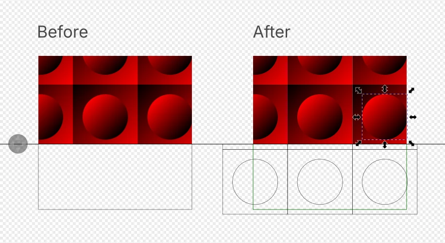
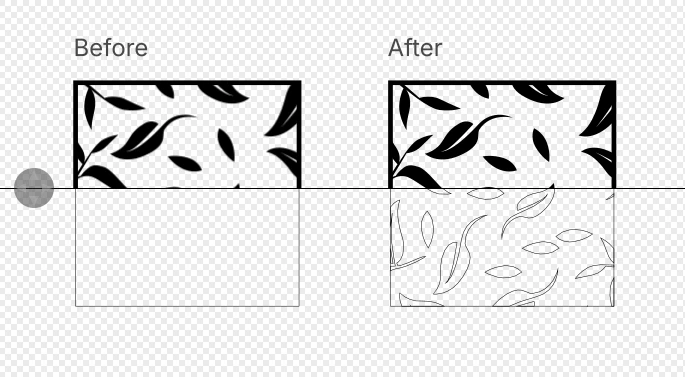

# FlatternPattern

FlatternPattern is an Inkscape extension. It replaces a pattern fill or a
pattern stroke with real geometry. The result looks the same as the pattern,
and plotters, cutters and other editors can use it.

Inkscape 1.4 has "Objects to Pattern" and "Pattern to Objects". "Pattern to
Objects" gives one tile only. FlatternPattern gives all the tiles that the
object shows, cut to the shape of the object.

The two images show a rectangle before and after the extension, in the
Inkscape split view. The top half shows the normal view. The bottom half
shows the outline view.

### Clipped copies

The result looks the same as the pattern fill. Each tile is a copy that you
can select and edit.

### Merged outlines

The result is one filled path.

## Contents

- [Requirements](#requirements)
- [Tested with](#tested-with)
- [Install](#install)
- [Use](#use)
- [Output modes](#output-modes)
  - [Clipped copies](#clipped-copies-1)
  - [Merged outlines](#merged-outlines-1)
- [Options](#options)
  - [Patterns with objectBoundingBox units](#patterns-with-objectboundingbox-units)
  - [Clips, masks and filters on the object](#clips-masks-and-filters-on-the-object)
- [Known limitations](#known-limitations)
- [How it works](#how-it-works)
- [Development](#development)
- [Reporting issues](#reporting-issues)
- [How this was made](#how-this-was-made)
- [License](#license)

## Requirements

- Inkscape 1.4. The development used Inkscape 1.4.4 on Linux.
- No other packages. The extension uses the `inkex` package that comes with
  Inkscape.

## Tested with

- Inkscape 1.4.4 on Manjaro Linux, with the bundled `inkex` 1.4.0 and
  Python 3.13.
- Not tested on Windows or macOS yet.

The automated test suite has 353 tests. The tests cover these items:

- The `href` chain of a pattern: inherited attributes, cycles, missing targets.
- Lengths with units, fractions and percentages.
- `patternUnits`, `patternContentUnits`, `patternTransform`, `viewBox` and
  `preserveAspectRatio`.
- The tile range. A test compares it with a brute-force overlap check for
  random transforms.
- The stroke area: caps, joins, miter limits, dashes and markers.
- Styles: inheritance from the pattern, not from the object, and stylesheets.
- Clips, masks, filters and opacity on the object, and `paint-order`.
- The selection: groups, text, clones, hatches and mesh gradients.
- The two output modes, the fallback to clipped copies, and the tile limit.
- The removal of unused definitions, and the `.inx` file.

105 of the tests are render comparisons. Each test renders the input and the
output to PNG with Inkscape or `rsvg-convert`. A pixel is different when one
color channel changes by more than 64 of 255. The test fails when more than
0.1 % of the pixels are different. The input files are the fixtures in
`tests/data/flatten/` and five files made in the Inkscape GUI in
`tests/data/real/`. Some inputs show a known difference between the renderers
or a known limit of merged outlines. These tests are expected failures, each
with its reason in the test file. One more test checks that the seam bleed
removes at least 90 % of the light seam pixels.

GitHub Actions runs the linters and all tests for each push to `main` and
each pull request. The test job uses Ubuntu 24.04 and Inkscape 1.4.4 from the
Inkscape PPA. The developer also runs the tests before each push of a version
change.

The coverage badge at the top of this file shows the part of the statements
in the extension code that the tests run. The value comes from the last CI
run on `main`.

## Install

Version: 0.1.1. The [change log](CHANGELOG.md) lists the changes in each
release.

1. Download the zip file from the
   [latest release](https://github.com/weiss-d/FlatternPattern/releases/latest).
2. Open the user extensions folder for your system (see the table).
3. Extract the files from the zip file into that folder.
4. Restart Inkscape.

To install the development version, copy `flatternpattern.inx` and all the
`.py` files in the top folder of this repository into the same folder.

| System | User extensions folder |
|---|---|
| Linux | `~/.config/inkscape/extensions/` |
| Linux, Flatpak | `~/.var/app/org.inkscape.Inkscape/config/inkscape/extensions/` |
| Windows | `%APPDATA%\inkscape\extensions\` |
| macOS | `~/Library/Application Support/org.inkscape.Inkscape/config/inkscape/extensions/` |

Inkscape shows the correct folder at Edit > Preferences > System > User
extensions.

## Use

1. Select one or more objects with a pattern fill or a pattern stroke.
2. Select Extensions > Modify Path > FlatternPattern.
3. Set the options (see the table).
4. Click Apply.

The extension also finds the objects in selected groups. To undo the change,
push Ctrl+Z one time.

The extension replaces each object with a group. The group has the id
`ID-flat`, where `ID` is the id of the object. The object stays in the group
with its own id. Its pattern paint changes to `none`.

## Output modes

### Clipped copies

This is the default mode. The extension puts one copy of the tile content in
each tile. A clip path with the shape of the object hides the rest. For a
stroke, a mask with the shape of the stroke hides the rest.

The result is exact. You can edit each copy. Some cutters do not support
masks. For these cutters, use merged outlines for the fill.

Shapes that meet at a tile edge can show a thin light line on the screen.
The renderer smooths the edge of each copy, and the two edges do not cover the
pixel fully. To hide these lines, select "Overlap clipped copies to hide
seams". Each filled shape then grows by the seam bleed, 0.2 px by default. In
tests with Inkscape and rsvg at 96 to 300 dpi, 0.2 px left at most 2 light
pixels on a full page. Tile content with an opacity below 1 gets a slightly
darker line at each edge.

### Merged outlines

The extension converts the strokes of the tile to paths and makes one filled
path for the object. Use this mode for stencils, plotters and cutters.

This mode starts Inkscape in the background, so it needs more time. The
merged path has the first color of the tile content and no transparency. The
extension shows a message when the tile has more than one color. It also shows
a message when a shape in the tile has an opacity below 0.99. Inkscape stock
patterns use values such as 0.995, which look opaque, so they get no message.

The extension makes clipped copies, and shows a message, in these cases:

- The object has a pattern stroke. This mode merges only pattern fills.
- Inkscape does not start, or it gives no result.
- The tile has an image, text, a filter, a mask, a clip, markers, a gradient
  or a nested pattern.

## Options

| Option | Default | Function |
|---|---|---|
| Output mode | Clipped copies | Selects clipped copies or merged outlines. |
| Also flatten stroke patterns | On | Flattens pattern strokes too. Pattern strokes always get clipped copies. |
| Keep a hidden copy of the original | Off | Puts a hidden copy of each object after its group, with the id `ID-original`. |
| Remove unused pattern definitions | On | Removes the patterns, clips, masks and filters that nothing uses after the change. |
| Maximum number of tiles | 2000 | Stops the extension when the selection needs more tiles. |
| Seam overlap (merged outlines) | 0.01 | Makes each tile larger by this distance in user units. This prevents thin gaps between merged tiles. |
| Overlap clipped copies to hide seams | Off | Makes the shapes in each clipped copy larger by the seam bleed. |
| Seam bleed (px) | 0.2 | Sets the distance for the option above, in px (1/96 in). |
| Match the Inkscape view, not the SVG standard | Off | Keeps the Inkscape view of patterns with `objectBoundingBox` units. |

### Patterns with objectBoundingBox units

Inkscape 1.4 shows some patterns with `objectBoundingBox` units at another
place than browsers do. By default, the output follows the SVG standard. Thus
the output can move in Inkscape. The extension shows a message for each such
object. To keep the Inkscape view, select "Match the Inkscape view, not the
SVG standard".

### Clips, masks and filters on the object

The clip, mask, filter and opacity of the object move to the new group. The
tiles make the box of the group larger than the box of the object. Thus the
extension converts a clip, mask or filter in `objectBoundingBox` units to a
copy in `userSpaceOnUse` units.

The extension does not convert the `primitiveUnits` of a filter. When a
filter uses `primitiveUnits="objectBoundingBox"`, the extension shows a
message. The filter result can look different.

## Known limitations

The extension skips these objects and shows a message:

- Text. Use Path > Object to Path, then run the extension again.
- Clones. Use Edit > Clone > Unlink Clone, then run the extension again.
- Hatch fills and mesh gradients.
- Pattern strokes that do not scale with the object
  (`vector-effect:non-scaling-stroke`).
- Patterns with a circular `href` chain, a negative size or a reference to a
  missing element.

When the selection needs more tiles than the maximum, the extension stops and
changes nothing. The message gives the number of tiles that the selection
needs.

A pattern with no area, or a pattern with no content, paints nothing. The
extension then sets the fill or the stroke to `none` and shows a message.

Other limits, with the behavior of the extension:

- Merged outlines give one color and no transparency. Pattern strokes and
  some tile contents get clipped copies instead (see
  [Merged outlines](#merged-outlines-1)).
- Clipped copies of a pattern stroke use a mask. Some cutters do not support
  masks.
- Clipped copies can show thin light seams on the screen. The seam bleed
  option hides most of them (see [Clipped copies](#clipped-copies-1)).
- A pattern with `objectBoundingBox` units can move in Inkscape, because the
  output follows the SVG standard. The extension shows a message (see
  [Patterns with objectBoundingBox units](#patterns-with-objectboundingbox-units)).
- The extension does not convert the `primitiveUnits` of a filter on the
  object. It shows a message (see
  [Clips, masks and filters on the object](#clips-masks-and-filters-on-the-object)).

## How it works

The extension does these steps for each object with a pattern paint:

1. Resolve the pattern. [`fp_resolve.resolve()`](fp_resolve.py) follows the
   `href` chain. Each attribute comes from the first pattern in the chain that
   sets it. The content comes from the first pattern with child elements. A
   circular chain stops the work for this object.
2. Find the tiles. [`fp_tiling.tile_box()`](fp_tiling.py) calculates the tile
   rectangle from the units and the box of the object.
   `content_transform()` adds the `viewBox` or the content units.
   `plan()` moves the box of the object back through the inverse
   `patternTransform`. It then keeps only the tiles that overlap the object.
   The extension adds the tile counts of all objects before it changes the
   document. Over the limit, it stops.
3. Clipped copies: [`fp_clipped.flatten_element()`](fp_clipped.py) puts one
   copy of the tile content in each tile, with the transform from
   `tile_transform()`. Each copy gets the full style that it had in the
   pattern. A tile clip cuts the content that goes out of the tile. A clip in
   the shape of the object cuts the full fill. A mask in the shape of the
   stroke cuts a stroke.
4. Merged outlines: [`fp_merged.merge_fills()`](fp_merged.py) starts Inkscape
   two times. The first run converts the strokes of the tile to paths, joins
   them, and cuts the result to the tile. The seam overlap makes the tile
   slightly larger. The second run joins all tile copies and cuts them to the
   shape of the object. The result is one path.

## Development

The development tools use [uv](https://docs.astral.sh/uv/).

1. Install the tools with `uv sync`.
2. Install the Git hooks with `uv run pre-commit install`.
3. Run the tests with `uv run pytest`.
4. To measure the coverage, run `uv run coverage run -m pytest`, then
   `uv run coverage report`.

The tests import `inkex` from `/usr/share/inkscape/extensions`. To use
another folder, set the `INKSCAPE_EXTENSIONS_DIR` environment variable. The
render tests need the `inkscape` and `rsvg-convert` commands. If a command is
not available, pytest skips the tests that need it.

`docs/spike-merged-mode.md` records the test of the Inkscape actions that
the merged outlines mode uses.

## Reporting issues

Report problems and requests on the
[issue tracker](https://github.com/weiss-d/FlatternPattern/issues). Attach a
small SVG file that shows the problem, if possible.

## How this was made

I made this extension with AI coding help (Claude Code). I designed the
extension, reviewed the code and tested it. 353 automated tests check it,
and 105 of them compare renders. I maintain it and answer the issues myself.

## License

MIT. See `LICENSE`.
